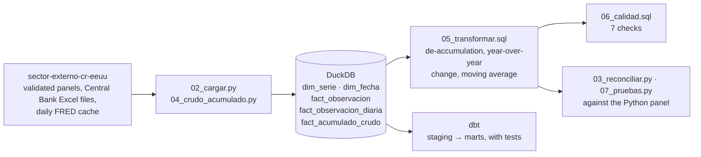

# A DuckDB and dbt warehouse for macroeconomic time series

*[Versión en español](README.md)*

**Question.** Can a macroeconomic panel already validated in Python be moved into a SQL
warehouse without changing a single number, and be given data-quality checks that tell
a data error from a real shock?

**Short answer.** Yes. The panel from my thesis
([`sector-externo-cr-eeuu`](https://github.com/pabloguerrerocr/sector-externo-cr-eeuu))
is rebuilt as a DuckDB star schema and reproduces the original in all 17
series-frequency comparisons, with differences below 1e-13. The quality checks return
0 errors and 3 warnings, and all three warnings are real macroeconomic shocks.



## Three findings

**1. Moving the data into SQL changed no numbers.** The panel's 12 series are stored
long (one row per series and date), and every aggregation is derived in SQL from the
finest grain. Compared against the Python panel, the 11 monthly and 6 quarterly series
match with differences between 0 and 3e-14. The dbt layer produces the same rows as
the hand-written SQL (1,056 + 264 + 1,056, zero differences with `EXCEPT` in both
directions).

**2. Averaging twice is not the same as averaging once.** The 2-year Treasury yield
(`t2y`) and the dollar index (`dolar`) are daily. Going from day to month and then to
quarter does not give the same result as going from day to quarter, because months
have different numbers of days: the difference reaches 0.02 points for the yield and
0.19 points for the index. That is why the warehouse keeps the daily grain and derives
the quarter from it. The same goes for quarterly GDP, which the monthly panel carries
forward: it is not stored, it is rebuilt with a `JOIN` against
`DATE_TRUNC('quarter', ...)`.

**3. The quality engine tells shocks from errors.** Seven checks that return **the rows
that fail**, not a boolean: gaps, duplicates, nulls, orphan series, improbable jumps,
de-accumulation mismatches and stale series. On this data they return 0 errors and 3
warnings:

| Series | Date | Detail |
|---|---|---|
| `ffr` | 2020-03 | −0.93 = 5.4 standard deviations: the Fed's emergency cut |
| `ipi_eeuu` | 2020-04 | −12.85 = 8.7 standard deviations: the COVID industrial collapse |
| `tpm` | 2022-08 | +1.74 = 5.0 standard deviations: the Central Bank's aggressive hike |

Flagging them is the right behavior: telling a real shock from a data error is the job
of someone who knows the series, not of the check.

## De-accumulation, in one expression

The Central Bank of Costa Rica publishes the trade balance and exports **as
year-to-date totals**: January holds January, February holds January plus February.
The monthly flow is the difference from the previous month *of the same year*; in
January the year-to-date value is already the flow. In SQL it is one window function:

```sql
valor - COALESCE(
    LAG(valor) OVER (PARTITION BY serie_id, YEAR(fecha) ORDER BY fecha),
    0
) AS flujo
```

Each year's flows add up to the December year-to-date value, and the result matches the
Python pipeline.

## Data

The warehouse does not copy the data: it reads it from the
[`sector-externo-cr-eeuu`](https://github.com/pabloguerrerocr/sector-externo-cr-eeuu)
repository, where it was validated. All of it is public: FRED (Federal Reserve Bank of
St. Louis) and the Central Bank of Costa Rica's economic indicators portal.

| Table | Rows | What it is |
|---|---:|---|
| `dim_serie` | 12 | the series, with frequency, provider and original title |
| `dim_fecha` | 132 | monthly calendar 2015-2025 with year, quarter and year-end |
| `fact_observacion` | 1,408 | one row per series and date |
| `fact_acumulado_crudo` | 264 | the Central Bank's year-to-date data, untouched |
| `fact_observacion_diaria` | 5,491 | the daily grain of the two FRED series, if the cache is present |

## Run it

The two repositories sit side by side:

```bash
git clone https://github.com/pabloguerrerocr/sector-externo-cr-eeuu.git
git clone https://github.com/pabloguerrerocr/warehouse-sector-externo.git
cd warehouse-sector-externo
pip install -r requirements.txt
python 07_pruebas.py        # rebuilds the warehouse from scratch and verifies it
python 03_reconciliar.py    # series by series against the validated panel
```

`07_pruebas.py` exits with code 1 if anything fails, so it can back a git hook or CI. If
the thesis repository lives elsewhere, point to it with the `TFG_DIR` variable.

The daily FRED grain is not versioned in the thesis repository. Without it,
`03_reconciliar.py` compares 15 of the 17 series and marks quarterly `t2y` and `dolar`
as *omitted*, not as passed. To compare all of them, run this in the thesis repository:
`python main.py --descargar-fred`.

The dbt layer (see [`dbt/`](dbt/)):

```bash
pip install dbt-duckdb
cd dbt
export DBT_PROFILES_DIR=.   # Windows: set DBT_PROFILES_DIR=.
dbt build                   # PASS 23 · WARN 1 · ERROR 0
```

Tested with Python 3.13, DuckDB 2.0 and dbt 1.12.

| File | What it does |
|---|---|
| `01_esquema.sql` | star schema, with a drop order that respects dependencies |
| `02_cargar.py` | wide panel to long, plus the daily FRED grain |
| `03_reconciliar.py` | compares each series against the validated CSVs (tolerance 1e-9) |
| `04_crudo_acumulado.py` | loads the year-to-date data **untouched**, as the Central Bank publishes it |
| `05_transformar.sql` | de-accumulation, year-over-year change and moving average, with window functions |
| `06_calidad.sql` | the 7 quality checks |
| `07_pruebas.py` | rebuilds from scratch and asserts everything |
| `tfg.py` | locates the thesis repository |
| `dbt/` | the same transformations as dbt models, with lineage and tests |
| `ejercicios/` | twelve SQL exercises on this warehouse, auto-graded (in Spanish) |

## Limitations

- **It depends on the thesis repository**, which is the validated source. That is
  deliberate: the warehouse proves it reproduces that source, so it does not duplicate
  it.
- **The daily FRED grain** is only there if the cache was downloaded; without it, two of
  the 17 comparisons are omitted.
- **The `sector_externo.duckdb` database is not versioned**: `07_pruebas.py` rebuilds it
  in seconds.
