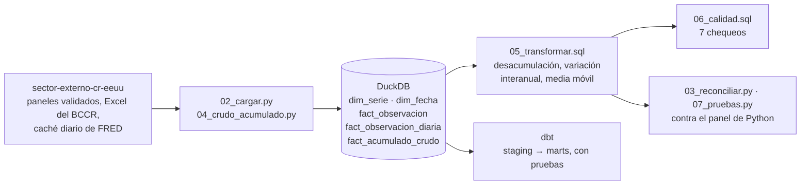

# Warehouse en DuckDB y dbt para series macroeconómicas

*[English version](README.en.md)*

**Pregunta.** ¿Se puede pasar un panel macroeconómico ya validado en Python a un
warehouse en SQL sin alterar un solo número, y dejarlo con chequeos de calidad que
distingan un error de dato de un choque real?

**Respuesta corta.** Sí. El panel de mi trabajo final de graduación
([`sector-externo-cr-eeuu`](https://github.com/pabloguerrerocr/sector-externo-cr-eeuu))
se reconstruye en un esquema estrella en DuckDB y reproduce el original en las 17
comparaciones de serie y frecuencia, con diferencias menores a 1e-13. Los chequeos de
calidad dan 0 errores y 3 avisos, y los tres avisos son choques macroeconómicos
reales.



## Tres hallazgos

**1. Mover los datos a SQL no alteró ningún número.** Las 12 series del panel se
guardan largas (una fila por serie y fecha) y cada agregación se deriva en SQL desde
el grano más fino. Comparadas contra el panel de Python, las 11 mensuales y las 6
trimestrales coinciden con diferencias de entre 0 y 3e-14. La capa dbt produce las
mismas filas que el SQL escrito a mano (1.056 + 264 + 1.056, cero diferencias con
`EXCEPT` en ambas direcciones).

**2. Promediar dos veces no es lo mismo que promediar una.** El bono a 2 años (`t2y`)
y el índice del dólar (`dolar`) son diarios. Llevarlos de día a mes y después a
trimestre no da lo mismo que de día a trimestre, porque los meses tienen distinto
número de días: la diferencia llega a 0,02 puntos en el bono y a 0,19 puntos en el
índice. Por eso el warehouse guarda el grano diario y deriva el trimestre desde ahí.
Lo mismo con el PIB trimestral que el panel mensual repite hacia adelante: no se
guarda, se reconstruye con un `JOIN` contra `DATE_TRUNC('quarter', ...)`.

**3. El motor de calidad distingue choques de errores.** Siete chequeos que devuelven
**las filas que fallan**, no un booleano: huecos, duplicados, nulos, series huérfanas,
saltos improbables, descuadre de la desacumulación y series desactualizadas. Sobre
estos datos dan 0 errores y 3 avisos:

| Serie | Fecha | Detalle |
|---|---|---|
| `ffr` | 2020-03 | −0,93 = 5,4 desviaciones: el recorte de emergencia de la Fed |
| `ipi_eeuu` | 2020-04 | −12,85 = 8,7 desviaciones: el desplome industrial por el COVID |
| `tpm` | 2022-08 | +1,74 = 5,0 desviaciones: el alza agresiva del BCCR |

Que el motor los marque es lo correcto: distinguir un choque real de un error de dato
es trabajo de quien conoce la serie, no del chequeo.

## La desacumulación, en una expresión

El BCCR publica el balance comercial y las exportaciones **acumulados dentro del
año**: enero trae enero y febrero trae enero más febrero. El flujo del mes es la
diferencia contra el mes anterior *del mismo año*; en enero el acumulado ya es el
flujo. En SQL es una función de ventana:

```sql
valor - COALESCE(
    LAG(valor) OVER (PARTITION BY serie_id, YEAR(fecha) ORDER BY fecha),
    0
) AS flujo
```

La suma de los flujos de cada año reproduce el acumulado de diciembre, y el resultado
coincide con el pipeline de Python.

## Datos

El warehouse no copia los datos: los lee del repositorio
[`sector-externo-cr-eeuu`](https://github.com/pabloguerrerocr/sector-externo-cr-eeuu),
que es donde se validaron. Todos son públicos: FRED (Reserva Federal de San Luis) y el
portal de indicadores económicos del BCCR.

| Tabla | Filas | Qué es |
|---|---:|---|
| `dim_serie` | 12 | las series, con su frecuencia, proveedor y título original |
| `dim_fecha` | 132 | calendario mensual 2015-2025 con año, trimestre y cierre de año |
| `fact_observacion` | 1.408 | una fila por serie y fecha |
| `fact_acumulado_crudo` | 264 | el acumulado del BCCR, sin tocar |
| `fact_observacion_diaria` | 5.491 | el grano diario de las dos series de FRED, si está el caché |

## Cómo correrlo

Los dos repositorios van uno al lado del otro:

```bash
git clone https://github.com/pabloguerrerocr/sector-externo-cr-eeuu.git
git clone https://github.com/pabloguerrerocr/warehouse-sector-externo.git
cd warehouse-sector-externo
pip install -r requirements.txt
python 07_pruebas.py        # reconstruye el warehouse desde cero y lo verifica
python 03_reconciliar.py    # serie por serie contra el panel validado
```

`07_pruebas.py` sale con código 1 si algo falla, así que sirve para un hook de git o
para CI. Si el TFG está en otra carpeta, se indica con la variable `TFG_DIR`.

El grano diario de FRED no está versionado en el repositorio del TFG. Sin él,
`03_reconciliar.py` compara 15 de las 17 series y marca `t2y` y `dolar` trimestrales
como *omitidas*, no como aprobadas. Para compararlas todas, en el repositorio del TFG:
`python main.py --descargar-fred`.

La capa dbt (ver [`dbt/`](dbt/)):

```bash
pip install dbt-duckdb
cd dbt
export DBT_PROFILES_DIR=.   # Windows: set DBT_PROFILES_DIR=.
dbt build                   # PASS 23 · WARN 1 · ERROR 0
```

Probado con Python 3.13, DuckDB 2.0 y dbt 1.12.

| Archivo | Qué hace |
|---|---|
| `01_esquema.sql` | esquema estrella, con el orden de borrado que respeta las dependencias |
| `02_cargar.py` | panel ancho a largo, más el grano diario de FRED |
| `03_reconciliar.py` | compara cada serie contra los CSV validados (tolerancia 1e-9) |
| `04_crudo_acumulado.py` | carga el acumulado **sin tocar**, tal como lo publica el BCCR |
| `05_transformar.sql` | desacumulación, variación interanual y media móvil, con ventanas |
| `06_calidad.sql` | los 7 chequeos de calidad |
| `07_pruebas.py` | reconstruye desde cero y afirma todo |
| `tfg.py` | ubica el repositorio del TFG |
| `dbt/` | las mismas transformaciones como modelos dbt, con linaje y pruebas |
| `ejercicios/` | doce ejercicios de SQL sobre este warehouse, con corrección automática |

## Limitaciones

- **Depende del repositorio del TFG**, que es la fuente validada. Es deliberado: el
  warehouse prueba que reproduce esa fuente, así que no la duplica.
- **El grano diario de FRED** solo está si se bajó el caché; sin él, dos de las 17
  comparaciones se omiten.
- **La base `sector_externo.duckdb` no se versiona**: se regenera en segundos con
  `07_pruebas.py`.
